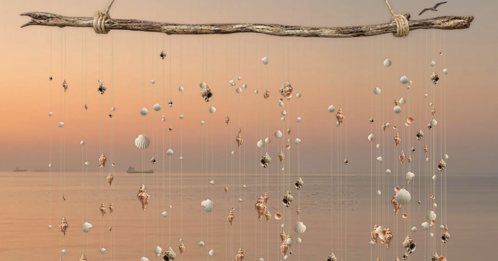

# ShellBreathe

**A small, calm web experience: a curtain of seashells by the sea that moves with your hand, plus an optional 40-second breathing exercise.**

🌊 **Try it:** https://hannazaho.github.io/ShellBreathe/

## What it is

Shells hang on thin threads in front of a sunset sea. Turn on your camera, wave a hand, and the curtain parts like in the wind. Each shell makes a soft sound when it is touched. No camera? The curtain still sways on its own, and you can press **Breathe** to follow a gentle breathing rhythm: 4 seconds in, 6 seconds out, 4 cycles.

I wanted something with meaning, a pleasant calming movement and sound, and a clear way to show how hand tracking and physics can feel in a browser.

## How to use it

1. Open the link on your phone or computer.
2. Press **Turn on camera** and wave your hand in front of it (optional).
3. Press **Breathe** for a ~40-second breathing exercise. Four dots show your progress. You can stop at any time or repeat.
4. Turn the sound on. On iPhone, check that the silent switch is off.

## Privacy

The camera is optional and off until you turn it on. The video is processed on your device. Nothing is recorded or sent anywhere.

## How it works

- **Hand tracking:** [MediaPipe Hand Landmarker](https://ai.google.dev/edge/mediapipe/solutions/vision/hand_landmarker) finds your hand in each camera frame and returns its points (landmarks). Extra filters ignore short false detections.
- **Physics:** every thread is a chain of points with distance constraints, simulated with Verlet integration at a fixed time step. Hand speed and finger touches push the threads. The shells are drawn on top of the threads.
- **Breathing mode:** a smooth offset is layered over the simulation, so the curtain opens on the inhale and closes on the exhale without breaking the physics.
- **Sound:** short recorded shell taps via the Web Audio API. Pitch depends on shell size, and the number of voices playing at once is limited so it never turns into noise.
- **Visuals:** a single HTML file with canvas rendering, a moving sea, and a drifting seagull.

Built with HTML, CSS, JavaScript, and MediaPipe. Hosted on GitHub Pages.

## How it was made

I'm a UX/UI designer, not a developer. I designed the experience, picked the visuals, recorded the sounds, and directed the build step by step, one change at a time. The code was written with [Claude](https://claude.ai) (Claude Code), and I tested every iteration on my Mac and my iPhone.

## Credits

- The idea of physically simulated hanging strings was inspired by an interactive curtain example by **Lain Egan** (seen on Instagram).
- Visuals (sea, branch, shells, seagull) were generated with AI in [Figma Weave](https://www.figma.com/weave/) and then edited by me. The sea was inspired by a real view I saw.
- Hand tracking by [MediaPipe](https://ai.google.dev/edge/mediapipe) (Google).

## License

- **Code:** [MIT License](LICENSE).
- **Images and sounds** in `assets/` are not covered by the MIT license. Please don't reuse them without asking. The images were generated with AI (see Credits), and the sounds were recorded by me.

## Author

Hanna · UX/UI designer · [GitHub](https://github.com/HannaZaho)
